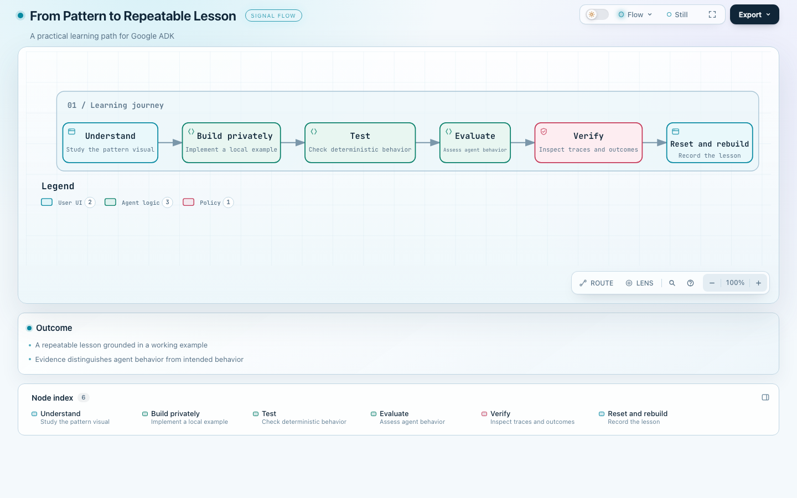
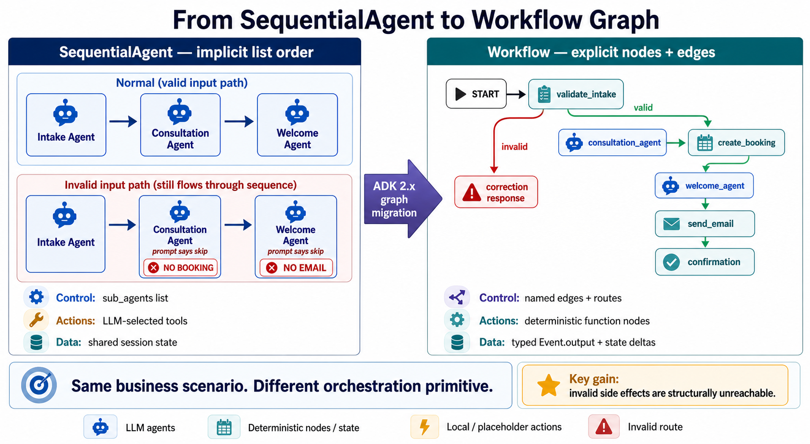

# Google ADK Orchestration Lab

A visual, hands-on learning lab for designing agent workflows with Google's Agent Development Kit (ADK). It combines an orchestration pattern atlas with independently structured example projects and graph engineering exercises. The curriculum is designed for developers and for creating clear, repeatable lessons for a learning community.

**The outcome:** learn to choose an orchestration pattern, implement it around a business problem, inspect what actually happened, and explain the result to someone else. The examples make abstract concepts tangible: client onboarding, retail analytics, and other business workflows.

## What you will find

- **A visual atlas:** 13 patterns, each with a diagram, explanation, tradeoffs, and related patterns in [visuals/](visuals/README.md).
- **Practical projects:** three standalone examples, including two versions of the same fitness-onboarding scenario and a retail analytics demonstration.
- **Graph engineering:** seven separate projects in the [showcase](showcase/README.md), covering fixed sequences, routing, fan-in, iteration, human input, nested workflows, and dynamic orchestration.
- **Experiments and references:** a lead qualification service in [graph-engineering/](graph-engineering/), the external [ADK 2 tutorial](https://github.com/cuppibla/adk2-tutorial), and a conceptual [interactive architecture simulator](interactive-video/README.md).
- **Ideas for later:** adjacent topics in [additional-patterns-worth-exploring/](additional-patterns-worth-exploring/README.md).

The atlas is about **how work is coordinated**: who chooses the next step, how data moves, where execution branches or waits, and what happens when a step fails. Some examples also explore integrations; they are not all multi-agent patterns.

## The learning journey



[Explore the interactive Archify learning path](docs/diagrams/learning-path.html) (download the HTML and open it locally for the interactive viewer).

Study the visual, build privately, test deterministic behavior, evaluate the agent, and verify actual outputs and traces. Then reset to a clean starting point and rebuild while recording. This is the intended teaching workflow, not a claim that every pattern already has a completed lesson.

## Start here

1. Choose a pattern from the [catalog](#pattern-catalog), starting with [sequential pipeline](visuals/sequential-pipeline/README.md) if you are new to orchestration.
2. Follow the [fitness onboarding lesson](examples/fitness-onboarding/README.md) to see intake, consultation, and welcome stages in a fixed order.
3. Compare it with the [graph version](examples/fitness-onboarding-graph/README.md), which applies explicit routing and deterministic action nodes to the same scenario.
4. Use the lesson's own setup, test, evaluation, and trace instructions. Each project has its own dependencies and configuration; there is no single root application to run.

### One scenario, two orchestration styles



| | Sequential lesson | Graph lesson |
|---|---|---|
| Control | `SequentialAgent` enters intake, consultation, then welcome in fixed order. | `Workflow` connects validation, consultation, booking, welcome, email, and confirmation nodes. |
| Invalid intake | All stages are entered; later agents are instructed not to use booking or email tools. | Validation routes to a correction terminal with no path to booking or email. |
| Actions | Local booking and email functions are exposed as agent tools. | Booking and email are explicit deterministic function nodes. |
| Outcome | A coach-facing consultation plan and welcome response, with structured tool results in state and traces. | The same business scenario demonstrates typed handoffs and an explicit control-flow boundary. |

Both are local prototypes with mock booking and email behavior; they do not send real email. Model calls still require the configured model service and credentials. Consult the lesson READMEs for exact prerequisites and documented verification.

## Projects and what they showcase

| Project | What it demonstrates | External requirements |
|---|---|---|
| [Fitness onboarding](examples/fitness-onboarding/README.md) | Fixed-order multi-agent coordination, session state, tools, and behavioral evaluation. | Configured model access; mock business actions. |
| [Fitness onboarding graph](examples/fitness-onboarding-graph/README.md) | Typed graph nodes, explicit routes, and a terminal invalid-input path. | Configured model access; mock business actions. |
| [BigQuery retail analytics](examples/bigquery-analytics-agent/README.md) | Natural-language analytics using `BigQueryToolset`, write blocking, and synthetic retail data. | Google Cloud credentials and a Terraform-managed BigQuery dataset; provisioning can incur costs. |
| [Graph engineering showcase](showcase/README.md) | Seven independently structured projects illustrating graph control-flow patterns across business scenarios. | Varies by project; read its setup and deployment instructions. |

Project documentation may record past test or evaluation results and deployment configurations. Those records are not proof of a current run or a deployed service. Review each project's commands, access needs, and evidence before use.

## Patterns and technologies

The examples use **Python** and **Google ADK**, including `LlmAgent`, `SequentialAgent`, graph `Workflow`, routes, `JoinNode`, and dynamic nodes. Depending on the project, they also demonstrate **Gemini/Vertex AI**, **Pydantic** contracts, **YAML** prompts, session state and tools, **MCP**, **BigQuery**, **Terraform**, **uv**, **pytest**, and **Agents CLI** runs and evaluations. These are project-specific capabilities, not dependencies required for every lesson.

## Pattern catalog

| # | Pattern | Core question | Primary ADK expression |
|---|---|---|---|
| 1 | [Coordinator and dispatcher](./visuals/coordinator-dispatcher/README.md) | Which specialist should handle this request? | `LlmAgent` + `sub_agents` or `AgentTool` |
| 2 | [Sequential pipeline](./visuals/sequential-pipeline/README.md) | What fixed steps must run in order? | `SequentialAgent` or graph chain |
| 3 | [Fan-out, parallel, and gather](./visuals/fan-out-parallel-gather/README.md) | Which independent branches can run together? | `ParallelAgent` + gather, or graph fan-out |
| 4 | [Hierarchical task decomposition](./visuals/hierarchical-task-decomposition/README.md) | How can a complex goal be recursively decomposed? | Nested parents, sub-agents, and `AgentTool` |
| 5 | [Generate and review](./visuals/generate-review/README.md) | How can one pass critique another pass? | Generator → reviewer sequence |
| 6 | [Iterative refinement](./visuals/iterative-refinement/README.md) | How do we improve until a stop condition is met? | `LoopAgent` or routed graph back-edge |
| 7 | [Human in the loop](./visuals/human-in-the-loop/README.md) | Where must execution pause for a person? | `RequestInput`, resumability, confirmation |
| 8 | [Conditional routing](./visuals/conditional-routing/README.md) | Which deterministic path should run? | `Workflow` routes + `Event(route=...)` |
| 9 | [Explicit graph fan-in](./visuals/explicit-graph-fan-in/README.md) | How do named branches synchronize explicitly? | `JoinNode` |
| 10 | [Map-style parallel worker](./visuals/parallel-worker/README.md) | How do we apply one operation to many items? | `parallel_worker=True` or `asyncio.gather` |
| 11 | [Nested workflows](./visuals/nested-workflows/README.md) | How do we compose reusable sub-workflows? | A `Workflow` used as another workflow's node |
| 12 | [Dynamic orchestration](./visuals/dynamic-orchestration/README.md) | What if topology depends on runtime data? | `@node` + `ctx.run_node` + Python control flow |
| 13 | [Collaborative task delegation](./visuals/collaborative-task-delegation/README.md) | How does a specialist execute a bounded task and return? | `mode="task"` or `mode="single_turn"` |

## The decision map

```text
Is the next step known in advance?
├── Yes
│   ├── Fixed order ----------------------> Sequential pipeline
│   ├── Different independent branches ---> Fan-out / gather
│   ├── Same work over a list ------------> Parallel worker
│   ├── One selected branch --------------> Conditional routing
│   ├── Repeat until acceptable ----------> Iterative refinement
│   └── Pause for a person ---------------> Human in the loop
└── No
    ├── LLM selects a specialist ---------> Coordinator / dispatcher
    ├── Bounded typed task ----------------> Collaborative task delegation
    ├── Goal recursively decomposes ------> Hierarchical decomposition
    └── Runtime code determines topology --> Dynamic orchestration
```

Cross-cutting compositions:

- Generate/review is a specialized sequence.
- Explicit graph fan-in is the graph-native form of gather.
- Nested workflows package any smaller pattern as a reusable node.

## Important ADK 2.x distinction

ADK exposes three complementary workflow styles:

- **Template workflow agents**: `SequentialAgent`, `ParallelAgent`, and
  `LoopAgent`. They remain useful for recognizing existing code, but the ADK 2.x
  documentation says graph workflows supersede template workflows for Python and
  Go.
- **Graph workflows**: explicit nodes, edges, routes, and joins. Best when the
  topology should be visible and deterministic.
- **Dynamic workflows**: normal Python loops, conditions, recursion, and async
  scheduling around `ctx.run_node`. Best when the topology depends on runtime data.

## How to study a pattern

1. Read its diagram and identify the goal and topology.
2. Ask who chooses the next step: code, the model, or a person.
3. Follow the data contract and read the tradeoffs and failure modes.
4. Compare it with a neighboring pattern, then try an applicable project.

The visual catalog includes conceptual teaching snippets; individual projects have their own scaffolds and runnable code. A diagram communicates the intended topology, so use tests, evaluations, tool traces, and observed outcomes to verify an implementation.

## Repository map

| Path | Purpose |
|---|---|
| [visuals/](visuals/README.md) | Pattern explanations and diagrams. |
| [examples/](examples/) | Standalone lesson and integration projects. |
| [showcase/](showcase/README.md) | Seven graph engineering projects. |
| [graph-engineering/](graph-engineering/) | Additional service experiment and reference material. |
| [interactive-video/](interactive-video/README.md) | Conceptual interactive architecture walkthrough and simulator. |
| [additional-patterns-worth-exploring/](additional-patterns-worth-exploring/README.md) | Adjacent and deferred topics. |

## Primary sources

- [ADK multi-agent workflow patterns](https://adk.dev/workflows/patterns/)
- [ADK workflows overview](https://adk.dev/workflows/)
- [Graph routes](https://adk.dev/graphs/routes/)
- [Dynamic workflows](https://adk.dev/graphs/dynamic/)
- [Collaborative workflows](https://adk.dev/workflows/collaboration/)
- [Human input](https://adk.dev/workflows/human-input/)
- [ADK Python API reference](https://adk.dev/api-reference/python/)
