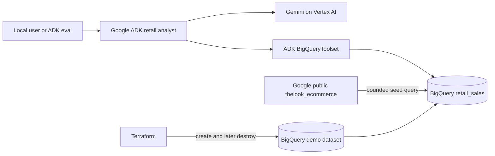

# Solution Architecture

## Requirements and design choice

The prototype needs a low-cost, repeatable dataset, natural-language BigQuery
analysis, local ADK execution, behavioral evals, and an explicit cleanup path.
A single-agent design is sufficient because the only capability is read-only
analytics over one curated table.

## Components

- **BigQuery dataset:** serverless analytics storage; there is no instance to
  start or stop.
- **Curated table:** a denormalized 2024 slice designed for understandable
  revenue, category, country, margin, and acquisition questions. Person-level
  names, email, and addresses are excluded.
- **ADK agent:** uses the official `BigQueryToolset`, restricted to table
  metadata and query execution.
- **Guardrails:** BigQuery writes are blocked, queries are capped at 100 MiB,
  results are capped at 50 rows, and jobs are labeled for audit/cost review.
- **Lifecycle:** Terraform owns the dataset; the seed query owns only its table
  contents. The cleanup script destroys the dataset but leaves the BigQuery API
  enabled.

## Source guidance

- [ADK BigQuery tool example](https://github.com/google/adk-docs/blob/main/examples/python/snippets/tools/built-in-tools/bigquery.py)
- [Google ADK data-science sample](https://github.com/google/adk-samples/tree/main/python/agents/data-science)
- [BigQuery public datasets](https://cloud.google.com/bigquery/public-data)
- [Create BigQuery datasets with Terraform](https://cloud.google.com/bigquery/docs/datasets#terraform)
- [Estimate and control BigQuery costs](https://cloud.google.com/bigquery/docs/best-practices-costs)
