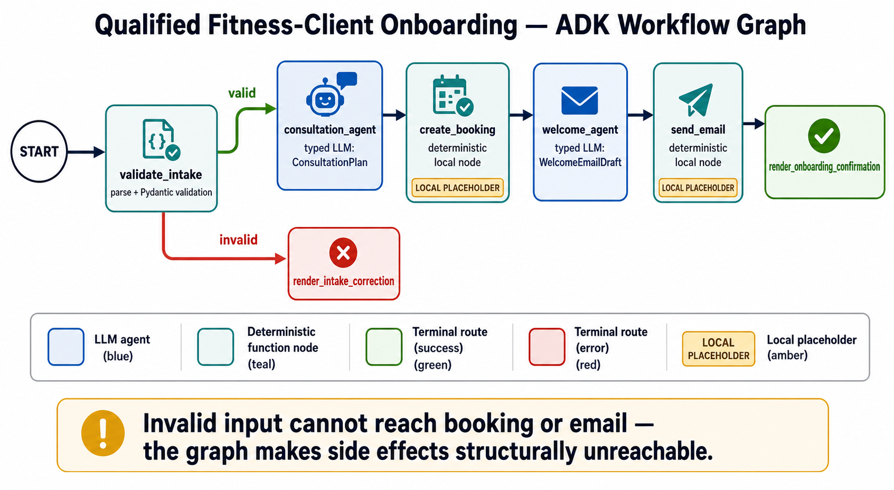
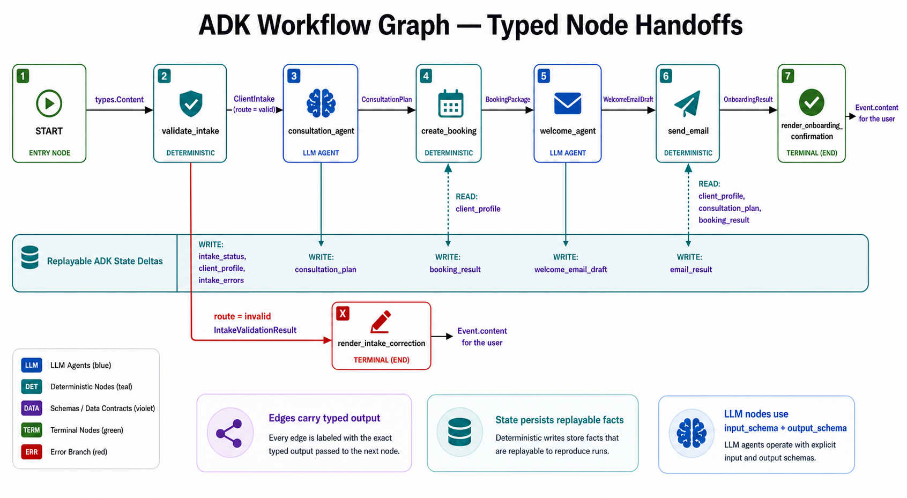
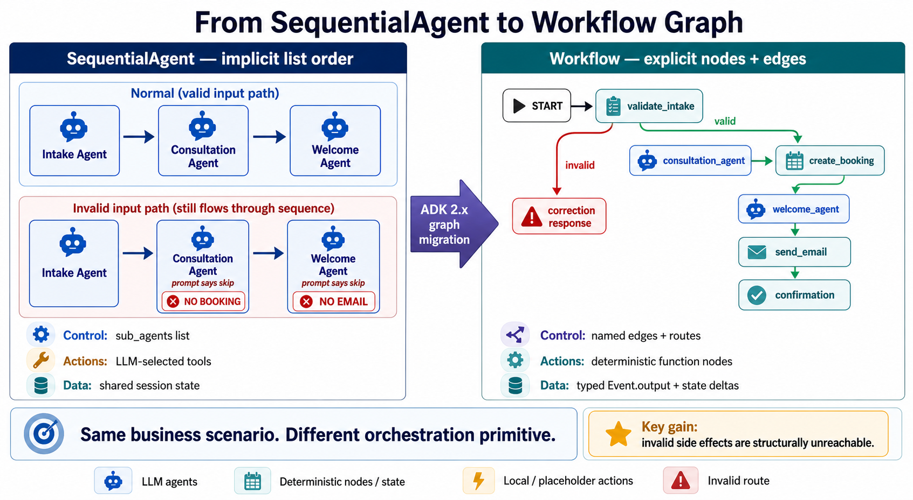
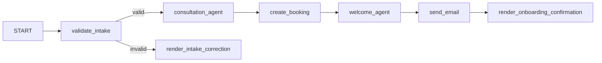

# Qualified Fitness-Client Onboarding — Graph Workflow

This local Google ADK lesson implements the same business scenario as the
`SequentialAgent` example, but uses the ADK 2.x `Workflow` graph API.

The client is already qualified. Budget qualification belongs in the later
conditional-routing lesson.

## Visual lesson

Study these in order before reading the implementation.

### 1. Routed workflow

Validation emits `valid` or `invalid`. The invalid route terminates immediately
and therefore cannot reach booking or email.



### 2. Typed node handoffs

Edges carry typed output to the next node, while event state deltas persist the
facts later nodes need.



### 3. SequentialAgent-to-Workflow migration

The business scenario stays the same. The orchestration moves from implicit
list order and prompt-gated actions to explicit nodes, edges, and routes.



The complete image set and recommended order are indexed in
[`visuals/README.md`](./visuals/README.md).

## Why use a graph?

The successful path is still sequential, but validation creates a real branch:



An invalid intake terminates at `render_intake_correction`. There is no edge
from that node to consultation, booking, welcome, or email. This is stronger
than telling later agents to skip side effects in their prompts.

## Structure

```text
app/
├── agent.py                 # ADK composition root: root_agent + app
├── agents/
│   ├── consultation.py      # Typed LLM-node builder
│   ├── welcome.py           # Typed LLM-node builder
│   └── onboarding.py        # Workflow graph builder and edges
├── models/
│   ├── client.py            # ClientIntake
│   ├── prompt.py            # PromptDefinition
│   └── results.py           # Typed node input/output contracts
├── prompts/
│   ├── loader.py            # Validated, cached YAML loader
│   ├── consultation_agent.yaml
│   └── welcome_agent.yaml
└── tools/
    ├── intake.py            # Parse, validate, route, reject
    ├── booking.py           # Deterministic local booking node
    ├── email.py             # Deterministic local email node
    └── response.py          # User-visible terminal response
```

The LLM agents have no tools. They transform typed data. Deterministic function
nodes own validation and production-shaped placeholder effects.

## Setup

```bash
agents-cli install
```

The generated GCP dependency set currently requires the explicitly pinned
`opentelemetry-resourcedetector-gcp>=1.12.0a0,<1.13.0`. Without that direct
constraint, `uv` rejects the dependency graph because version `1.13.0` is
yanked. This is recorded in `pyproject.toml` and `uv.lock`.

## Run a complete intake

The workflow accepts either raw JSON or an instruction containing one JSON
object. The instruction-shaped input better represents an application invoking
the graph after a form submission:

```bash
agents-cli run 'Onboard this qualified fitness client using the submitted intake:
{"name":"Jordan Lee","email":"jordan@example.com","primary_goal":"Build consistent strength","experience_level":"Beginner","availability":"Monday, Wednesday, and Friday evenings","physical_constraints":"Previous knee discomfort; avoid assumptions","preferred_consultation_time":"Tuesday at 6:00 PM Eastern"}'
```

Expected path:

```text
validate_intake
→ consultation_agent
→ create_booking
→ welcome_agent
→ send_email
→ render_onboarding_confirmation
```

Expected terminal response contains:

- the client goal and physical constraint;
- a deterministic `https://booking.example.com/...` URL;
- a local-placeholder email status and deterministic message ID.

No real booking or email is created.

## Run an incomplete intake

```bash
agents-cli run 'Onboard this qualified fitness client using the submitted intake:
{"primary_goal":"Build consistent strength"}'
```

Expected path:

```text
validate_intake → render_intake_correction
```

The response lists missing fields. Consultation, booking, welcome, and email
nodes are unreachable.

## ADK web UI

```bash
agents-cli playground
```

Paste either representative input above. Function nodes communicate downstream
through `Event.output`, persist replayable deltas through `Event.state`, and
select a branch through `Event.route`. Terminal function nodes also emit
`Event.content`, because internal `output` alone does not render in the web UI.

Graph event paths include execution suffixes such as `validate_intake@1`. Those
suffixes identify a node execution, while the graph node remains
`validate_intake`.

## Test and evaluate

```bash
agents-cli lint
uv run pytest tests/unit tests/integration
uv build
agents-cli eval generate --output artifacts/traces/final.json
agents-cli eval grade \
  --traces artifacts/traces/final.json \
  --config tests/eval/eval_config.yaml \
  --output artifacts/grade_results/final_domain
```

The final evaluation covers:

- `graph_route_policy`: exact valid/invalid author trajectory and required
  production-shaped results;
- `onboarding_response_quality`: a graph-aware Gemini judge for fact
  preservation, clarity, and local-placeholder honesty;
- `onboarding_safety_policy`: deterministic no-invented-email, rejection
  privacy, and no-diagnosis/treatment checks.

### Why the generic managed metrics are not the final gate

ADK graph traces omit deterministic function nodes from conversational events.
The managed `final_response_quality` metric therefore sees no tool-call
`response_steps` and treats the booking/email results as unsupported, even
though the graph executed those nodes. Its baseline is retained under
`artifacts/grade_results/`.

The managed `safety` metric also consistently flags the incomplete form for
requesting required name/email fields while passing the complete form that
contains those values. That general PII policy is not aligned with this
consented onboarding contract. The domain safety metric checks the actual
lesson rules directly.

## SequentialAgent comparison

| Concern | SequentialAgent lesson | Graph lesson |
|---|---|---|
| Fixed valid order | `sub_agents=[...]` | Unconditional edges |
| Invalid behavior | Later prompts inspect state and skip tools | Invalid route terminates structurally |
| Business actions | Tools selected by an LLM | Explicit deterministic nodes |
| Data handoff | Shared session state and output keys | Typed `Event.output` plus state deltas |
| Topology | Implicit list order | Explicit inspectable graph |

Use the sequential lesson first to understand fixed ordering. Use this graph
lesson to teach explicit routing, typed node boundaries, and topology tests.

## Recording reset

To reproduce the untouched scaffold in a separate practice directory:

```bash
cd ../
agents-cli scaffold create fitness-graph-practice \
  --agent adk \
  --prototype \
  --agent-guidance-filename AGENTS.md \
  --output-dir .
```

Do not run that command while `fitness-graph-practice/` already exists. The CLI
must create the target directory itself.

## Current scope

- Local prototype only (`deployment_target: none`)
- No CI/CD, Terraform, cloud deployment, CRM, database, booking provider, or
  email provider
- Preserved scaffold FastAPI and A2A entrypoints
- Model preserved as `gemini-3.6-flash` with three retry attempts
