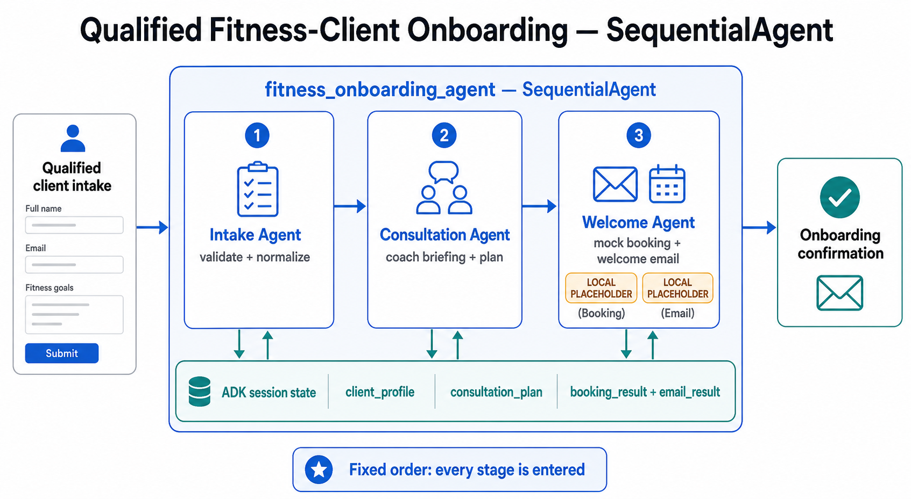
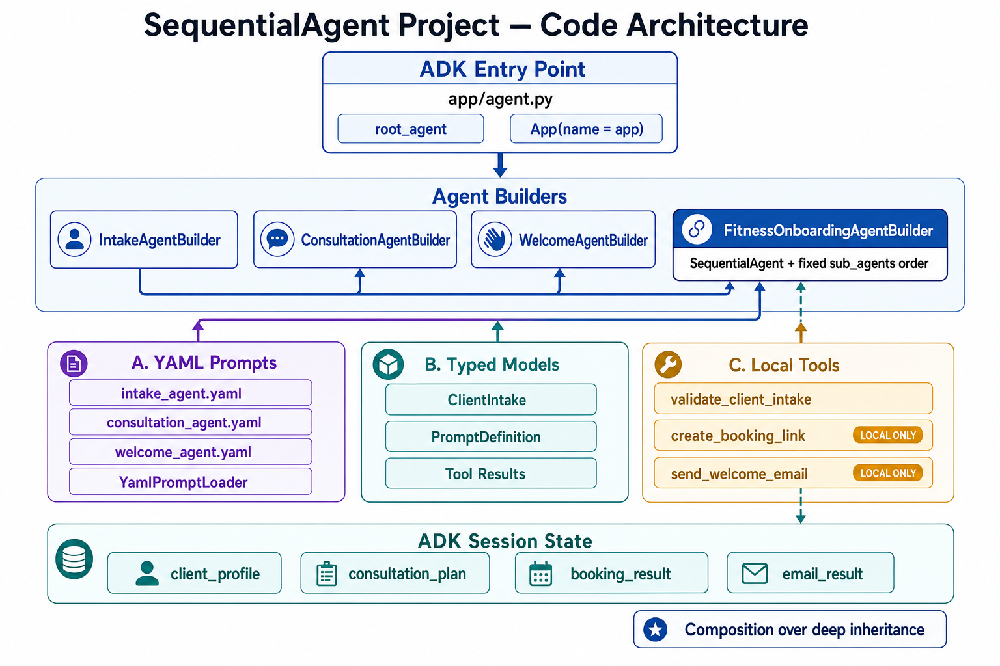
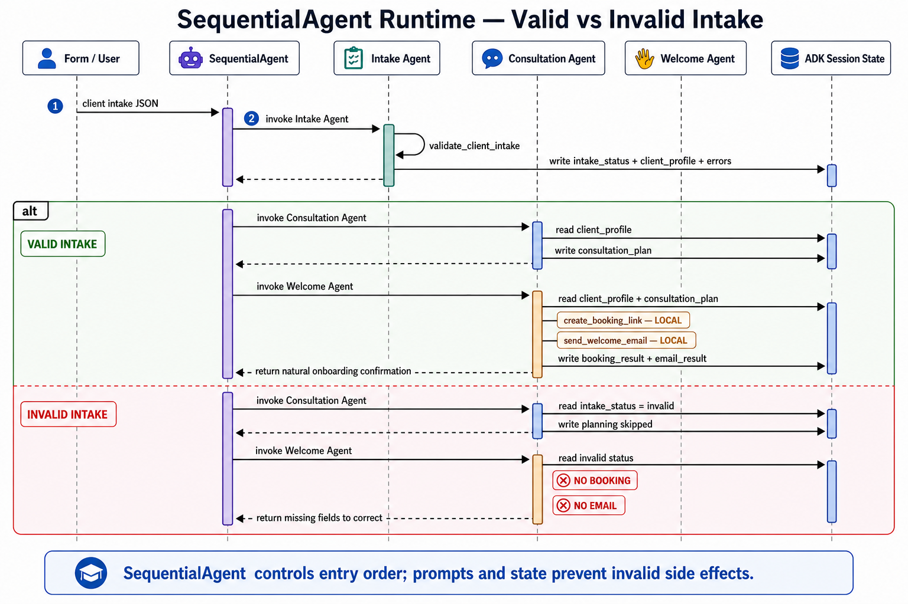

# Qualified Fitness-Client Onboarding

A practical Google ADK lesson that demonstrates a fixed sequence of specialized
agents:

```text
Intake Agent → Consultation Agent → Welcome Agent
```

The client is already qualified before this sequence starts. Qualification and
budget decisions belong in the conditional-routing lesson.

## Visual lesson

Study these in order before reading the implementation.

### 1. Fixed-sequence mental model

The root `SequentialAgent` enters all three agents in a fixed order. Session
state carries each stage's result forward.



### 2. Code architecture

`app/agent.py` composes builders whose dependencies come from YAML prompts,
typed models, and local tools. The design uses composition rather than a deep
inheritance hierarchy.



### 3. Valid and invalid runtime behavior

Invalid input does not hard-stop the sequence. Later agents are still entered,
but prompt instructions and session state prevent booking and email calls.



The complete image set and recommended order are indexed in
[`visuals/README.md`](./visuals/README.md).

## What the example teaches

- `SequentialAgent` for deterministic stage ordering.
- Shared session state with `output_key` and `ToolContext`.
- Thin, typed, deterministic function tools.
- Pydantic models for executable data contracts.
- Versioned YAML prompts loaded outside Python code.
- Builder classes that create fresh ADK agent hierarchies.
- The difference between deterministic pytest coverage and behavioral ADK
  evaluation.

## Architecture

```text
app/
├── agent.py                    # ADK composition root: root_agent + app
├── agents/
│   ├── intake.py              # IntakeAgentBuilder
│   ├── consultation.py        # ConsultationAgentBuilder
│   ├── welcome.py             # WelcomeAgentBuilder
│   └── onboarding.py          # FitnessOnboardingAgentBuilder
├── models/
│   ├── client.py              # ClientIntake
│   ├── results.py             # Typed tool results
│   └── prompt.py              # PromptDefinition
├── prompts/
│   ├── loader.py              # YamlPromptLoader
│   ├── intake_agent.yaml
│   ├── consultation_agent.yaml
│   └── welcome_agent.yaml
└── tools/
    ├── intake.py              # validate_client_intake
    ├── booking.py             # create_booking_link
    └── email.py               # send_welcome_email
```

The scaffold-generated `fast_api_app.py`, `app_utils/`, A2A routes, Dockerfile,
Agent Runtime manifest, and Terraform remain intact.

## Stage contracts

| Stage | Tools | State written |
|---|---|---|
| Intake | `validate_client_intake` | `intake_status`, `client_profile`, `intake_errors`, `intake_summary` |
| Consultation | None | `consultation_plan` |
| Welcome | `create_booking_link`, `send_welcome_email` | `booking_result`, `email_result`, `onboarding_response` |

The root agent resets onboarding state at the start of every invocation so a
new form cannot inherit booking or email results from a previous submission.

## Representative input

Paste this fictional intake into `agents-cli run` or the ADK playground:

```json
{
  "name": "Jordan Lee",
  "email": "jordan@example.com",
  "primary_goal": "Build consistent strength",
  "experience_level": "Beginner",
  "availability": "Monday, Wednesday, and Friday evenings",
  "physical_constraints": "Previous knee discomfort; avoid high-impact assumptions",
  "preferred_consultation_time": "Tuesday at 6:00 PM Eastern"
}
```

Expected trace:

1. `intake_agent` calls `validate_client_intake`.
2. `consultation_agent` reads the normalized profile and prepares a coach
   briefing.
3. `welcome_agent` calls `create_booking_link`.
4. `welcome_agent` includes that URL in the email body and calls
   `send_welcome_email`.
5. `welcome_agent` returns a natural onboarding confirmation.

The booking URL uses the reserved `booking.example.com` domain. The email tool
records a deterministic local result. Neither tool contacts an external
service.

## Invalid intake

`SequentialAgent` enters every sub-agent unless the invocation is paused.
Therefore, validation errors do not terminate the ADK shell itself:

- The validation tool stores `intake_status="invalid"` and field errors.
- Consultation and welcome prompts inspect that status.
- Booking and email tools must not run.
- The final agent explains what needs correction.

This intentionally demonstrates agent-level rejection. A production form or
API would normally enforce a hard validation boundary before invoking ADK.

## Local development

```bash
agents-cli install
agents-cli lint
uv run pytest tests/unit tests/integration
uv build
```

Quick terminal smoke test:

```bash
agents-cli run '{"name":"Jordan Lee","email":"jordan@example.com","primary_goal":"Build consistent strength","experience_level":"Beginner","availability":"Monday, Wednesday, and Friday evenings","physical_constraints":"Previous knee discomfort","preferred_consultation_time":"Tuesday at 6:00 PM Eastern"}'
```

Interactive ADK UI:

```bash
agents-cli playground
```

Behavioral evaluation:

```bash
agents-cli eval generate
agents-cli eval grade
```

Pytest checks deterministic Python contracts. ADK evaluation checks model
behavior such as tool selection, order, safety, fact preservation, and final
response quality.

The evaluation uses a local `multi_agent_tool_policy` metric for exact stage and
tool policy. Google Agent Platform's built-in
`multi_turn_tool_use_quality` autorater currently rejects traces containing
multiple agents, so it is not suitable for this sequence.

## Verified result

The implemented lesson was verified with:

- `agents-cli lint`: Ruff, formatting, codespell, and `ty` all passed.
- `uv run pytest tests/unit tests/integration`: 18 tests passed.
- `uv build`: the source distribution and wheel built successfully, including
  all three YAML prompt resources.
- Verbose complete-intake smoke test: validation, consultation, booking, email,
  and final confirmation ran in order.
- Verbose incomplete-intake smoke test: only validation ran; consultation and
  welcome agents reported the error without booking or email calls.
- Two-case ADK evaluation:
  - Multi-agent tool policy: `1.0`
  - Final-response quality: `1.0`, 100% pass rate
  - Safety: `1.0`, 100% pass rate
  - Onboarding response quality: `5.0/5`

Generated traces live under `artifacts/traces/`, and the complete JSON and HTML
grade reports live under `artifacts/grade_results/`.

## Common lesson failures

- **No model response in a direct pytest runner:** load the existing project
  `.env` before running the model so Vertex AI configuration reaches the lazy
  Gemini client.
- **Prompt crashes on missing state:** initialize every placeholder-backed
  state key before the sequence begins.
- **Agent already has a parent:** builders must create fresh child agents for
  every root composition.
- **YAML prompt missing after deployment:** load prompts with
  `importlib.resources` and verify they are present in the built wheel.
- **Built-in tool-use grading returns HTTP 400:** the built-in multi-turn tool
  autorater does not support multi-agent traces; use the deterministic local
  trajectory metric included in this project.

## Screen-recording reset

Keep this verified project as the answer key. Create a separate clean scaffold
for the recording so the working solution is never destroyed:

```bash
agents-cli scaffold create fitness-onboarding \
  --agent adk \
  --deployment-target agent_runtime \
  --region us-east1 \
  --cicd-runner skip \
  --agent-guidance-filename AGENTS.md \
  --output-dir /absolute/path/to/recording-workspace \
  --auto-approve
```

Rebuild in lesson checkpoints:

1. Add explicit Pydantic and PyYAML dependencies.
2. Create models and deterministic tools.
3. Add and validate YAML prompts.
4. Build the three LLM agents.
5. Compose the root `SequentialAgent`.
6. Add deterministic tests.
7. Smoke test, evaluate, and inspect the trace.

Use only fictional client data in the recording, screenshots, and saved traces.

## ADK 2.2 compatibility note

ADK 2.2 still supports `SequentialAgent` but marks it deprecated in favor of
the graph-based `Workflow` API. This lesson intentionally uses
`SequentialAgent` because its learning objective and visual are the classic
fixed-order agent pattern. A follow-up migration lesson should implement the
same business sequence with current Workflow nodes and typed edges.

## Deployment boundary

The scaffold targets Agent Runtime, but this implementation is intentionally
local-first. Deployment, cloud infrastructure changes, CI/CD, and real booking
or email providers require separate approval after evaluations pass.
