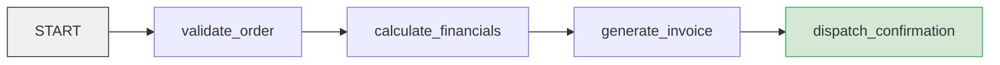

# 01 — Sequential Pipeline Graph (`order_fulfillment_graph`)

This showcase project demonstrates the **Sequential Pipeline Graph** pattern in Google ADK 2.x, replacing legacy template agents (`SequentialAgent`) with an explicit, typed, and auditable directed graph.

---

## 1. Pattern Overview

In ADK 1.x, linear workflows were typically expressed using `SequentialAgent([agent_a, agent_b])`. In ADK 2.x, graph engineering structures sequential logic as explicit edges connecting typed nodes:



### Why a Graph Over `SequentialAgent`?
1. **Explicit Data Contracts:** Data flows directly from one node's typed `output` to the next node's input, verified via Pydantic schemas.
2. **Deterministic Side Effects:** Deterministic nodes (e.g. tax calculations, invoice generation) run as pure Python functions without LLM hallucination or stochastic drift.
3. **State Deltas & Event Sourcing:** Each stage produces an `Event` with an explicit `state_delta` (`order_id`, `invoice_number`, `grand_total`), establishing an immutable audit trail in `session.events`.

---

## 2. Project Architecture

```text
app/
├── __init__.py
├── agent.py         # Composition root: Workflow + App export
├── models.py        # Typed Pydantic models (OrderInput, ValidatedOrder, etc.)
└── nodes.py         # Stage function nodes with @node decorators
tests/
├── test_graph.py    # Unit & Runner tests (pytest)
└── eval/
    ├── eval_config.yaml
    ├── eval_metrics.py
    └── datasets/
        └── basic-dataset.json
```

---

## 3. Quickstart & Testing

### A. Run Deterministic Unit Tests
```bash
uv run pytest
```

### B. Run Behavioral Evaluations
```bash
agents-cli eval run
```

---

## 4. Deployment to Agent Engine

This project is scaffolded and configured for direct deployment to **Google Cloud Vertex AI Agent Engine** (`agent_runtime`):

```bash
# Dry run check
agents-cli deploy -n --deployment-target agent_runtime --project <GCP_PROJECT_ID> --region us-central1

# Deploy to Agent Engine
agents-cli deploy --deployment-target agent_runtime --project <GCP_PROJECT_ID> --region us-central1
```
