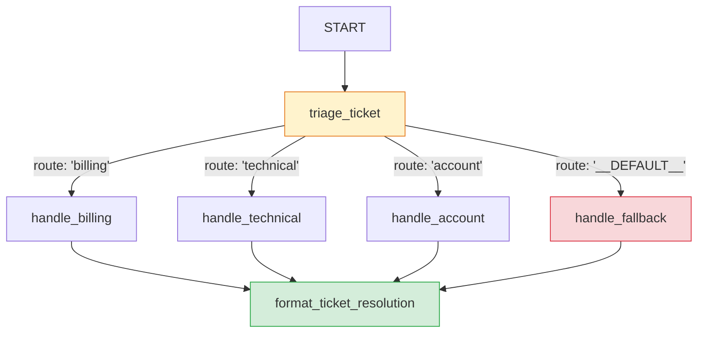

# 02 — Conditional Routing Graph (`service_desk_router_graph`)

This showcase project demonstrates the **Conditional Routing & Branch Selection** pattern in Google ADK 2.x, using explicit graph routing dictionaries and default fallback paths.

---

## 1. Pattern Overview

Unlike Coordinator/Dispatcher models where an LLM heuristically guesses which tool to invoke, conditional routing uses deterministic classifiers or business rules to emit a `route` signal via `EventActions(route=...)`. The ADK `Workflow` engine inspects the route and activates strictly the matching branch:



### Key Engineering Features
1. **Deterministic Branch Gating:** Unmatched paths are structurally bypassed.
2. **Explicit Fallback (`DEFAULT_ROUTE`):** Any ticket not matching explicit categories triggers the `__DEFAULT__` fallback edge to prevent workflow dead-ends.
3. **Auditability:** The chosen route is persisted in `session.state["triage_route"]`.

---

## 2. Quickstart & Testing

### Run Tests
```bash
uv run pytest
```

### Run Behavioral Evals
```bash
agents-cli eval run
```

---

## 3. Deployment to Agent Engine

Scaffolded with `deployment_target: agent_runtime` in `agents-cli-manifest.yaml`:

```bash
# Dry run check
agents-cli deploy -n --deployment-target agent_runtime --project <GCP_PROJECT_ID> --region us-central1

# Deploy to Vertex AI Agent Engine
agents-cli deploy --deployment-target agent_runtime --project <GCP_PROJECT_ID> --region us-central1
```
