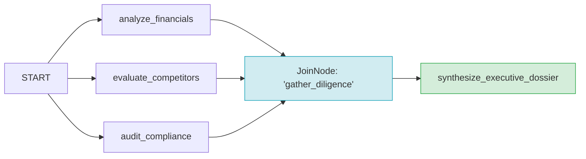

# 03 — Explicit Graph Fan-In with `JoinNode` (`due_diligence_graph`)

This showcase project demonstrates the **Explicit Graph Fan-In & Synchronization Barrier** pattern in Google ADK 2.x, using `JoinNode` to coordinate concurrent, heterogeneous branches.

---

## 1. Pattern Overview

When multiple tasks can run concurrently (fan-out), a synchronization barrier is required before downstream nodes can consume the unified results (fan-in). The `JoinNode` suspends until every predecessor node completes, then aggregates their outputs into a dictionary keyed by predecessor node name:



### How `JoinNode` Works
1. `JoinNode(name="gather_diligence")` registers internal flag `_requires_all_predecessors = True`.
2. The runtime schedules all predecessors (`analyze_financials`, `evaluate_competitors`, `audit_compliance`) concurrently.
3. Upon completion of all 3 branches, `JoinNode` passes `{ "analyze_financials": ..., "evaluate_competitors": ..., "audit_compliance": ... }` to `synthesize_executive_dossier`.

---

## 2. Quickstart & Testing

### Run Tests
```bash
uv run pytest
```

### Run Behavioral Evals
```bash
agents-cli eval run
```

---

## 3. Deployment to Agent Engine

Scaffolded with `deployment_target: agent_runtime` in `agents-cli-manifest.yaml`:

```bash
# Dry run check
agents-cli deploy -n --deployment-target agent_runtime --project <GCP_PROJECT_ID> --region us-central1

# Deploy to Vertex AI Agent Engine
agents-cli deploy --deployment-target agent_runtime --project <GCP_PROJECT_ID> --region us-central1
```
