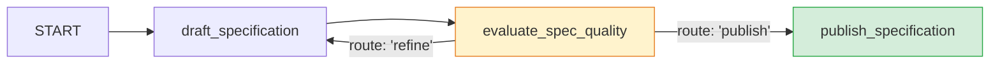

# 04 — Iterative Refinement Cyclic Graph (`spec_refinement_graph`)

This showcase project demonstrates the **Iterative Refinement & Evaluator-Optimizer** pattern in Google ADK 2.x, using cyclic back-edges guarded by conditional routes and loop limits.

---

## 1. Pattern Overview

In ADK 1.x, looping typically relied on `LoopAgent`. In ADK 2.x, cyclic graphs provide full transparency into iteration states, critique feedback, and exit criteria:



### ADK Graph Validation Rules for Cycles
1. **No Unconditional Cycles:** ADK's `Workflow.validate_graph()` strictly rejects unconditional cycles (e.g. `A -> B -> A` without routes) to prevent infinite execution loops.
2. **Conditional Routing Gate:** Every cycle **must contain at least one conditional route**. Here, `evaluate_spec_quality` emits `"refine"` to loop back or `"publish"` to terminate.
3. **Loop Bound Protection:** Iteration limits (`max_iterations = 3`) ensure termination even under edge cases.

---

## 2. Quickstart & Testing

### Run Tests
```bash
uv run pytest
```

### Run Behavioral Evals
```bash
agents-cli eval run
```

---

## 3. Deployment to Agent Engine

Scaffolded with `deployment_target: agent_runtime` in `agents-cli-manifest.yaml`:

```bash
# Dry run check
agents-cli deploy -n --deployment-target agent_runtime --project <GCP_PROJECT_ID> --region us-central1

# Deploy to Vertex AI Agent Engine
agents-cli deploy --deployment-target agent_runtime --project <GCP_PROJECT_ID> --region us-central1
```
