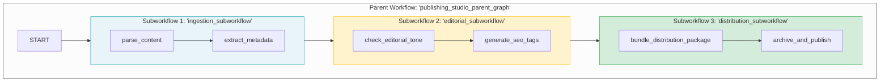

# 06 — Nested Sub-Workflows Graph (`publishing_studio_parent_graph`)

This showcase project demonstrates the **Nested Sub-Workflows & Hierarchical Composition** pattern in Google ADK 2.x, showing how entire `Workflow` graphs can act as individual nodes inside a parent `Workflow`.

---

## 1. Pattern Overview

As agent systems grow, defining all nodes and edges inside a single flat graph leads to monolithic, difficult-to-test diagrams. Because `google.adk.workflow.Workflow` subclasses `BaseNode`, any compiled workflow can be plugged directly as a node into another workflow:



### Key Architectural Benefits
1. **Encapsulated Scope:** Each subworkflow manages its own internal state transitions and validation rules independently.
2. **Reusability:** The same `ingestion_subworkflow` can be reused in different parent graphs (e.g. mobile app publisher, newsletter pipeline, or documentation indexer).
3. **Isolated Testing:** Each subworkflow can be unit-tested in isolation without instantiating the entire parent system.

---

## 2. Quickstart & Testing

### Run Tests
```bash
uv run pytest
```

### Run Behavioral Evals
```bash
agents-cli eval run
```

---

## 3. Deployment to Agent Engine

Scaffolded with `deployment_target: agent_runtime` in `agents-cli-manifest.yaml`:

```bash
# Dry run check
agents-cli deploy -n --deployment-target agent_runtime --project <GCP_PROJECT_ID> --region us-central1

# Deploy to Vertex AI Agent Engine
agents-cli deploy --deployment-target agent_runtime --project <GCP_PROJECT_ID> --region us-central1
```
