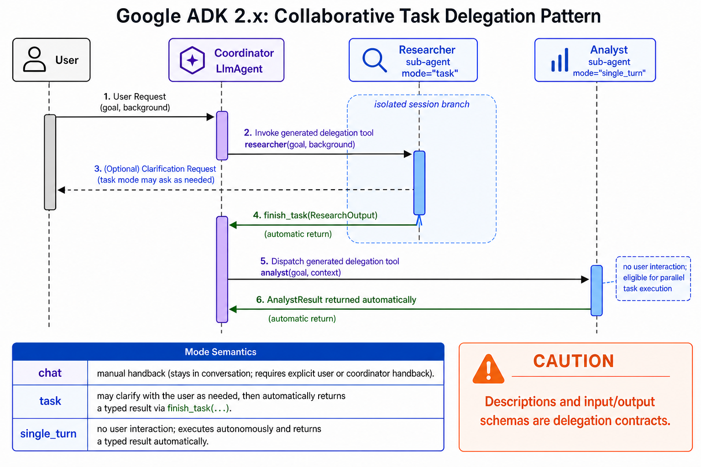

# Collaborative Task Delegation



## What it solves

A coordinator assigns a bounded task to a specialist and receives a defined result
back automatically. This is more contract-like than an open-ended conversational
transfer.

```text
coordinator --researcher(goal, background)--> specialist
coordinator <--finish_task(structured result)-- specialist
```

The coordinator's generated delegation tool is named after the sub-agent. A task
mode specialist uses `finish_task` to return; a single-turn specialist returns its
result automatically.

## ADK expression

ADK 2.x sub-agents can use collaboration modes:

- `task`: the specialist may ask clarification questions and returns through
  `finish_task`.
- `single_turn`: the specialist runs autonomously without user interaction and can
  participate in parallel task execution.
- `chat`: the default conversational transfer mode, which returns manually.

```python
class ResearchOutput(BaseModel):
    summary: str

researcher = LlmAgent(
    name="researcher",
    model="gemini-flash-latest",
    mode="task",
    description="Researches one assigned topic.",
    output_schema=ResearchOutput,
    instruction="Complete the task, then call finish_task.",
)

coordinator = LlmAgent(
    name="coordinator",
    model="gemini-flash-latest",
    sub_agents=[researcher],
)
```

The specialist runs in an isolated session branch. The coordinator receives its
result rather than its peers seeing intermediate reasoning.

## Use when

- Delegation should have typed inputs and outputs.
- The parent needs automatic return after task completion.
- Specialist context should be isolated from peer branches.

## Avoid when

- The user should converse freely with the specialist; use `chat` transfer.
- The agent is a graph-workflow root; collaboration mode support has graph-specific
  restrictions that must be checked for the installed ADK version.
- A deterministic function or tool can perform the task more reliably.

## Failure modes

- Missing descriptions weaken the generated delegation contract.
- A task agent never calls `finish_task`.
- Schemas are too broad to validate meaningful completion.
- Task-mode agents must remain leaves; the current ADK documentation says they
  cannot own sub-agents.

## Nearest neighbor

[Coordinator and dispatcher](../coordinator-dispatcher/) focuses on selecting a
specialist; collaborative task delegation focuses on the bounded execution and
automatic return contract after selection.

## Source

[Official collaborative workflow documentation](https://adk.dev/workflows/collaboration/)
