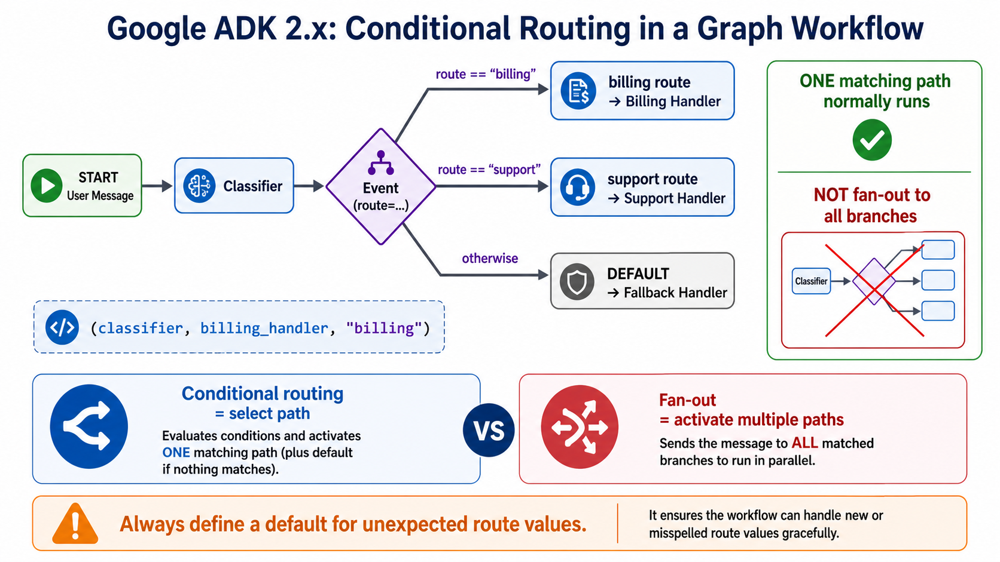

# Conditional Routing



## What it solves

A deterministic classifier or rule selects the next path. Unlike fan-out, routing
normally activates one matching branch rather than every branch.

```text
input -> classify --billing--> billing handler
                  --support--> support handler
                  --default--> fallback
```

## ADK expression

In a graph workflow, a node returns an `Event` whose `route` value is matched by
outgoing edges.

```python
from google.adk.events.event import Event
from google.adk.workflow import Workflow

def classify(node_input: str):
    if "invoice" in node_input.lower():
        return Event(output=node_input, route="billing")
    return Event(output=node_input, route="support")

root_agent = Workflow(
    name="router",
    edges=[
        ("START", classify),
        (classify, billing_handler, "billing"),
        (classify, support_handler, "support"),
        (classify, fallback_handler, "__DEFAULT__"),
    ],
)
```

Routes can be strings, booleans, integers, or multiple route values. Include a
default path when the route domain is not closed.

## Use when

- Routing rules can be written and tested directly.
- Auditability and predictable branch selection matter.
- Different categories require different processing paths.

## Avoid when

- Every branch should run.
- Classification depends on broad semantic judgment that rules cannot capture.
- Branches need to synchronize later; combine routing with explicit fan-in.

## Failure modes

- Missing default edges drop unexpected categories.
- A route label differs from its edge matcher.
- Business rules become buried inside an oversized classifier node.

## Nearest neighbor

[Coordinator and dispatcher](../coordinator-dispatcher/) lets an LLM choose a
specialist; this pattern makes the route explicit in code.

## Source

[Official graph routing documentation](https://adk.dev/graphs/routes/#route-branches-and-conditional-execution)

