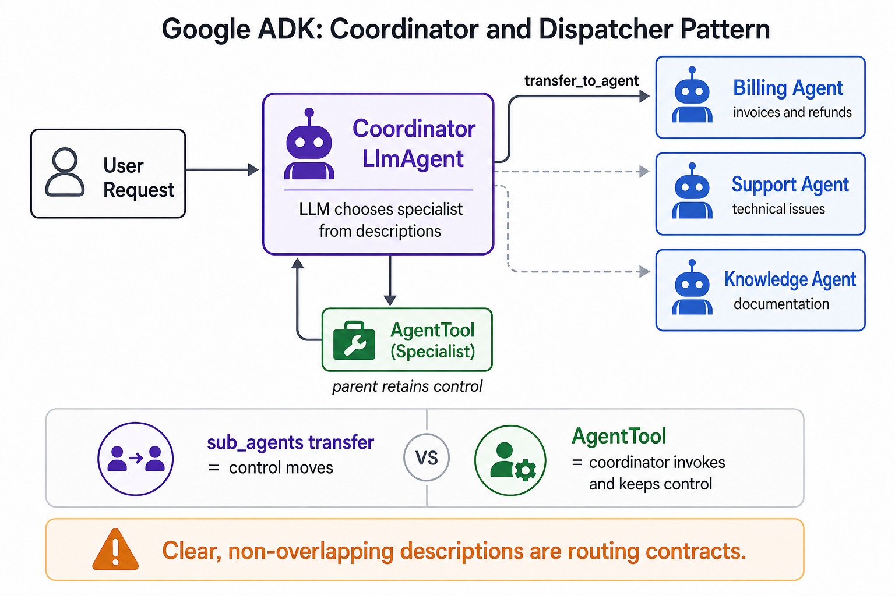

# Coordinator and Dispatcher



## What it solves

A coordinator receives an open-ended request and chooses the specialist best able
to handle it. The routing decision is made by an LLM from the specialists'
descriptions and the coordinator's instruction.

```text
user -> coordinator --billing question--> billing specialist
                    \-support question--> support specialist
```

## ADK expression

There are two related forms:

- Put specialists in `sub_agents` to allow LLM-driven transfer. Control moves to
  the selected specialist.
- Wrap specialists with `AgentTool` when the coordinator should invoke them and
  retain control.

```python
from google.adk.agents import LlmAgent

billing = LlmAgent(
    name="billing",
    description="Handles invoices, charges, and refunds.",
)
support = LlmAgent(
    name="support",
    description="Handles login and technical problems.",
)

coordinator = LlmAgent(
    name="coordinator",
    model="gemini-flash-latest",
    instruction="Route each request to the best specialist.",
    sub_agents=[billing, support],
)
```

Descriptions are routing contracts. If they overlap or omit boundaries, delegation
becomes unreliable.

## Use when

- Requests vary and cannot be classified with simple deterministic rules.
- Specialists have clearly separated domains.
- Some model discretion is valuable.

## Avoid when

- Compliance requires a deterministic route.
- Every branch should run; that is fan-out, not dispatch.
- One fixed process always applies; use a sequence instead.

## Failure modes

- Ambiguous specialist descriptions cause misrouting.
- Transfers can bounce between peers unless transfer boundaries are controlled.
- The coordinator may answer directly instead of delegating unless instructed and
  evaluated.

## Nearest neighbor

[Conditional routing](../conditional-routing/) also selects a branch, but routing
is encoded in graph logic rather than delegated to an LLM.

## Source

[Official coordinator and dispatcher pattern](https://adk.dev/workflows/patterns/#coordinator-and-dispatcher)

