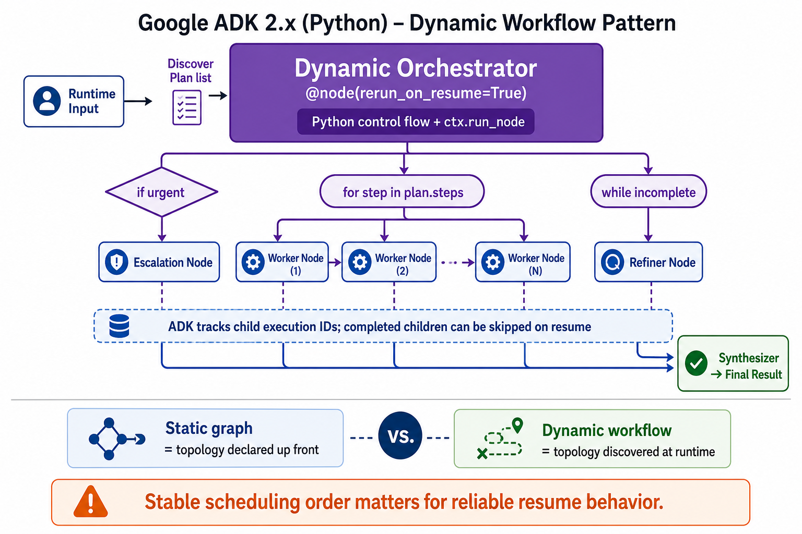

# Dynamic Orchestration



## What it solves

The execution topology depends on runtime data and would be awkward as a static
graph. A dynamic orchestrator uses ordinary Python conditions, loops, recursion,
and async scheduling while ADK still tracks child node executions.

```text
input -> orchestrator
         ├── if urgent: run escalation node
         ├── for each item: run worker node
         └── while incomplete: run refinement node
```

## ADK expression

Decorate the orchestrator with `@node(rerun_on_resume=True)` and invoke child nodes
through `ctx.run_node`.

```python
from google.adk.workflow import node

@node(rerun_on_resume=True)
async def orchestrate(ctx, node_input):
    plan = await ctx.run_node(planner, node_input=node_input)
    results = []
    for step in plan.steps:
        results.append(await ctx.run_node(worker, node_input=step))
    return await ctx.run_node(synthesizer, node_input=results)
```

ADK gives dynamically scheduled child nodes deterministic execution identities and
checkpoint behavior, so completed children can be skipped on resume.

## Use when

- Branch count or loop count is discovered at runtime.
- Normal language control flow is easier to understand than a large graph.
- Recursive or highly conditional orchestration is required.

## Avoid when

- A static graph communicates the topology more clearly.
- Scheduling order is unstable across resumes.
- Arbitrary model output directly controls dangerous side effects.

## Failure modes

- Reordering dynamic child calls changes execution identities and resume behavior.
- Directly awaiting each child accidentally serializes independent work.
- Complex orchestration bodies become monoliths instead of composed nodes.

## Source

[Official dynamic workflow documentation](https://adk.dev/graphs/dynamic/)

