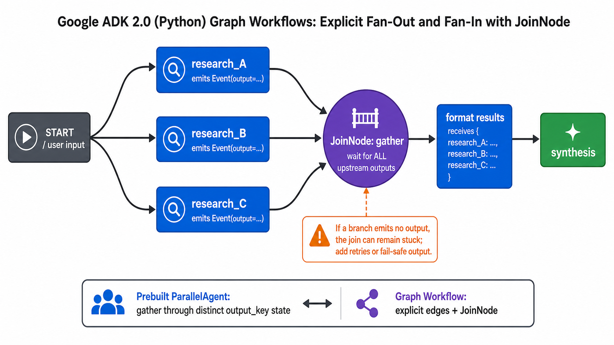

# Explicit Graph Fan-in with JoinNode



## What it solves

Named parallel graph branches need a real synchronization barrier before a
downstream node can consume all results.

```text
START -> research_A --\
      -> research_B ---+-> JoinNode -> format -> synthesis
      -> research_C --/
```

## ADK expression

`JoinNode` waits for every predecessor to emit an output and then emits a mapping
keyed by predecessor name.

```python
from google.adk.workflow import JoinNode, Workflow

gather = JoinNode(name="gather")

root_agent = Workflow(
    name="research_graph",
    edges=[
        ("START", research_a, gather),
        ("START", research_b, gather),
        ("START", research_c, gather),
        (gather, format_results),
        (format_results, synthesis),
    ],
)
```

The downstream node receives a shape like
`{"research_a": output_a, "research_b": output_b}`.

## Use when

- The topology should be explicit and inspectable.
- Named branches produce different result types.
- Downstream work requires all upstream outputs.

## Avoid when

- Partial results should continue without waiting for every branch.
- The same worker is applied to list items; use a parallel worker.
- A simple template composition is sufficient for existing ADK 1.x code.

## Failure modes

- A predecessor that emits no output leaves the join waiting.
- Unstructured LLM output breaks serialization or downstream typing.
- The slowest predecessor controls end-to-end latency.

Use structured `output_schema` for LLM nodes and retries or fail-safe outputs for
flaky predecessors.

## Source

[Official fan-out and JoinNode documentation](https://adk.dev/graphs/routes/#parallel-tasks-fan-out-and-join-paths)

