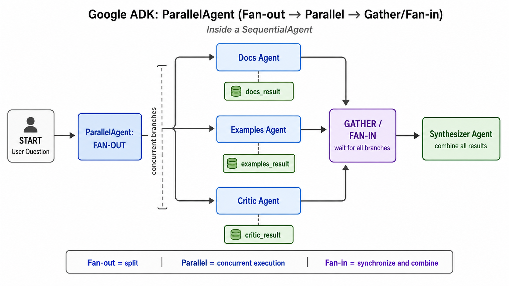

# Fan-out, Parallel, and Gather



## What it solves

One request is split into independent named branches, those branches run
concurrently, and a later stage combines their results.

```text
                -> docs ------\
input -> fan-out -> examples ---+-> gather -> synthesis
                -> critic -----/
```

These terms describe separate phases:

- **Fan-out** activates multiple branches.
- **Parallel** means their execution overlaps.
- **Gather/fan-in** synchronizes and combines results.

## ADK expression

The classic form nests a `ParallelAgent` and a synthesizer inside a
`SequentialAgent`. Give every branch a distinct `output_key`.

```python
root = SequentialAgent(
    name="research_pipeline",
    sub_agents=[
        ParallelAgent(name="research", sub_agents=[docs, examples, critic]),
        synthesizer,
    ],
)
```

The graph-native form fans edges out and uses a `JoinNode`; see
[explicit graph fan-in](../explicit-graph-fan-in/).

## Use when

- Branches do not depend on one another.
- You need multiple sources, perspectives, or independent checks.
- A final result needs all branch outputs.

## Avoid when

- Each branch performs the same operation over list items; use a parallel worker.
- One branch depends on another; use a sequence.
- Only one branch should run; use routing.

## Failure modes

- Shared output keys create races.
- The slowest branch determines gather latency.
- Synthesis may lose provenance unless branch identities are preserved.

## Source

[Official parallel fan-out and gather pattern](https://adk.dev/workflows/patterns/#parallel-fan-out-and-gather)

