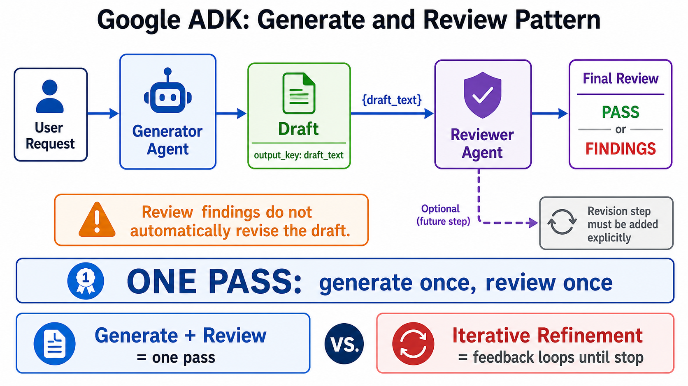

# Generate and Review



## What it solves

One agent creates an artifact and a separate reviewer critiques or validates it.
Separating the roles reduces the chance that generation and evaluation collapse
into the same reasoning pass.

```text
request -> generator -> draft -> reviewer -> findings
```

## ADK expression

The basic form is a two-stage sequence. The generator saves `draft_text`; the
reviewer reads it and saves `review_status` or structured feedback.

```python
review_pipeline = SequentialAgent(
    name="write_and_review",
    sub_agents=[generator, reviewer],
)
```

This pattern does not automatically revise the draft. Add a revision stage for one
fixed correction pass, or use iterative refinement for repeated correction.

## Use when

- Quality benefits from a second independent role.
- You need fact checking, policy review, linting, or rubric scoring.
- Review findings should remain visible even if the draft is accepted.

## Avoid when

- A deterministic validator can enforce the requirement more reliably.
- The reviewer has no evidence or rubric beyond the generator's context.
- Repeated correction is required; use refinement instead.

## Failure modes

- Reviewer and generator share the same blind spots.
- Vague rubrics produce agreeable but shallow reviews.
- Review text is generated but never gates downstream behavior.

## Nearest neighbor

[Iterative refinement](../iterative-refinement/) feeds review findings back into
another generation pass.

## Source

[Official generate and review pattern](https://adk.dev/workflows/patterns/#generate-and-review-pattern)

