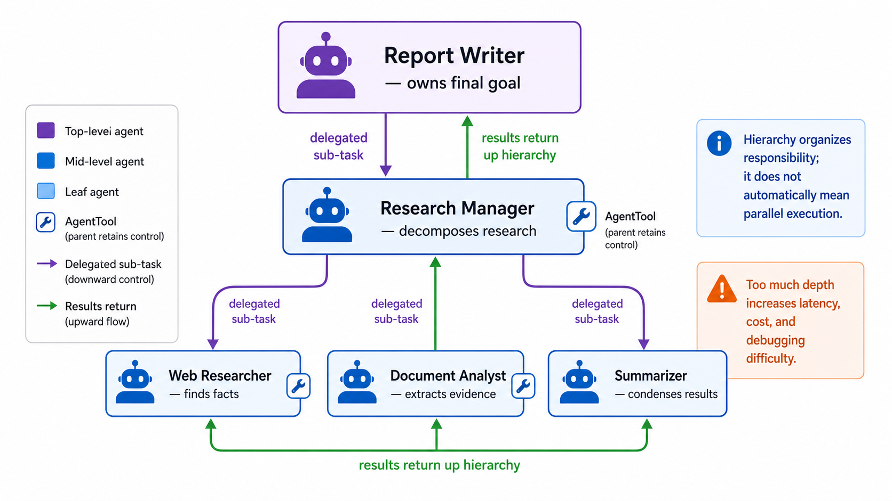

# Hierarchical Task Decomposition



## What it solves

A complex goal is recursively broken into smaller goals. High-level agents plan
and delegate; lower-level agents perform bounded specialist work; results flow
back up the tree.

```text
report writer
└── research manager
    ├── web researcher
    └── summarizer
```

## ADK expression

ADK represents the hierarchy with multiple parent/sub-agent levels or with
`AgentTool` wrappers when each parent should keep control.

```python
from google.adk.tools import AgentTool

research_manager = LlmAgent(
    name="research_manager",
    tools=[AgentTool(web_researcher), AgentTool(summarizer)],
)

report_writer = LlmAgent(
    name="report_writer",
    tools=[AgentTool(research_manager)],
)
```

The hierarchy is organizational; it does not automatically imply parallelism.
Each level still needs an execution policy.

## Use when

- The goal naturally decomposes into domains and subdomains.
- Different levels need different context or tools.
- You want reusable teams behind a simpler top-level interface.

## Avoid when

- A flat coordinator can select specialists directly.
- The hierarchy adds hops without reducing context or complexity.
- Strict latency matters more than decomposition quality.

## Failure modes

- Context and instructions are diluted across levels.
- Excessive depth increases cost, latency, and debugging difficulty.
- Responsibilities overlap, causing duplicate work or delegation loops.

## Nearest neighbor

[Collaborative task delegation](../collaborative-task-delegation/) defines a
bounded typed contract for one delegation edge; hierarchy composes many such
edges into a tree.

## Source

[Official hierarchical task decomposition pattern](https://adk.dev/workflows/patterns/#hierarchical-task-decomposition)

