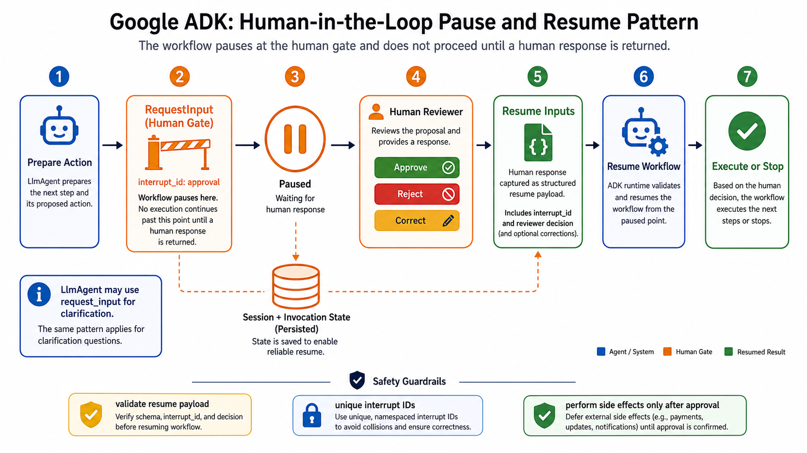

# Human in the Loop



## What it solves

Execution pauses at a deliberate decision point so a person can approve, reject,
correct, or supply missing information. The workflow then resumes from persisted
state.

```text
prepare -> request input -> PAUSED -> human reply -> resume -> act
```

## ADK expression

In graph workflows, a node yields `RequestInput`. On resume, replies are available
through `ctx.resume_inputs`, keyed by a unique interrupt ID. Application-level
resumability must preserve the session and invocation state.

```python
from google.adk.events.request_input import RequestInput

async def approval_node(ctx, node_input):
    if "approval" not in ctx.resume_inputs:
        yield RequestInput(
            interrupt_id="approval",
            message="Approve this action?",
            payload=node_input,
        )
        return
    yield Event(output=ctx.resume_inputs["approval"])
```

An `LlmAgent` can also receive the built-in `request_input` tool for model-initiated
clarification. Tool confirmation and policy plugins are related governance forms.

## Use when

- An action is irreversible, costly, privileged, or legally sensitive.
- The model lacks information only a person can provide.
- Human judgment is part of the process definition.

## Avoid when

- A deterministic policy can safely decide automatically.
- The runtime cannot persist and resume reliably.
- The human is asked to approve low-value steps so often that approvals become
  automatic rubber stamps.

## Failure modes

- Reused interrupt IDs collide, especially inside loops.
- Resume payloads are not validated.
- External side effects occur before approval or repeat after resume.

## Source

- [Official human-in-the-loop pattern](https://adk.dev/workflows/patterns/#human-in-the-loop)
- [ADK human input and resume behavior](https://adk.dev/workflows/human-input/)

