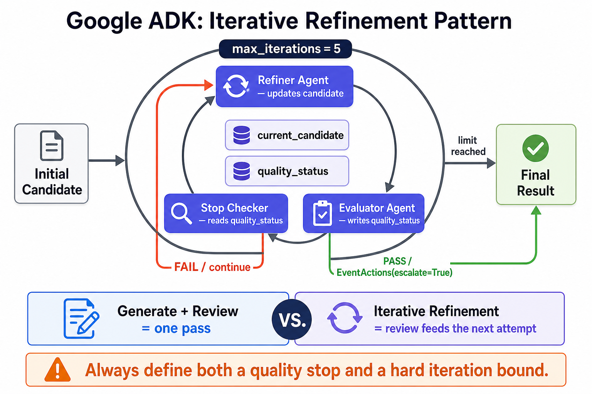

# Iterative Refinement



## What it solves

A candidate is repeatedly refined and evaluated until it meets a quality threshold
or reaches a hard iteration limit.

```text
candidate -> refine -> evaluate --pass--> finish
              ^          |
              \---fail---/
```

## ADK expression

Template code commonly uses `LoopAgent`. A checking agent emits an event with
`escalate=True` to stop the loop, while `max_iterations` provides a hard bound.
Graph workflows express the same behavior with a routed back-edge.

```python
loop = LoopAgent(
    name="refinement_loop",
    sub_agents=[refiner, evaluator, stop_checker],
    max_iterations=5,
)
```

The evolving candidate and evaluation result must have explicit state or event
contracts.

## Use when

- Feedback can materially improve a candidate.
- Success can be expressed by a useful evaluator or deterministic check.
- The additional latency and cost are justified.

## Avoid when

- There is no measurable stop condition.
- The task has irreversible side effects on each iteration.
- One review pass is sufficient.

## Failure modes

- No hard limit creates an infinite or very expensive loop.
- A permissive evaluator stops too early; a harsh one never stops.
- Repeated prompting causes drift instead of convergence.

## Nearest neighbor

[Generate and review](../generate-review/) runs a single generator/critic pass and
does not feed critique back automatically.

## Source

[Official iterative refinement pattern](https://adk.dev/workflows/patterns/#iterative-refinement)

