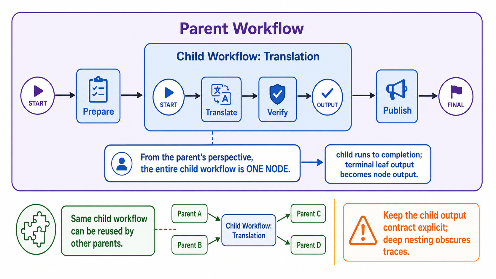

# Nested Workflows



## What it solves

A complex workflow is packaged as a reusable node inside a larger workflow. The
parent sees one encapsulated capability while the child keeps its internal graph.

```text
parent START -> prepare -> [child workflow: A -> B -> C] -> finish
```

## ADK expression

A `Workflow` can be placed as a node in another workflow's edge list.

```python
child = Workflow(
    name="translation_workflow",
    edges=[("START", translate), (translate, verify)],
)

parent = Workflow(
    name="publishing_workflow",
    edges=[("START", prepare), (prepare, child), (child, publish)],
)
```

The child runs to completion from the parent's perspective. Its terminal leaf
output becomes the nested workflow's output for the parent edge.

## Use when

- A sub-process is reusable across several larger workflows.
- The parent should not know every internal child step.
- Teams need ownership boundaries around workflow modules.

## Avoid when

- The child contains only one trivial step.
- The parent must route on every internal child event.
- Deep nesting obscures execution traces.

## Failure modes

- Multiple terminal leaves make the exposed output contract unclear.
- State names collide between parent and child.
- Excessive nesting makes debugging and retries difficult to localize.

## Source

[Official nested workflow documentation](https://adk.dev/graphs/routes/#nested-workflows)

