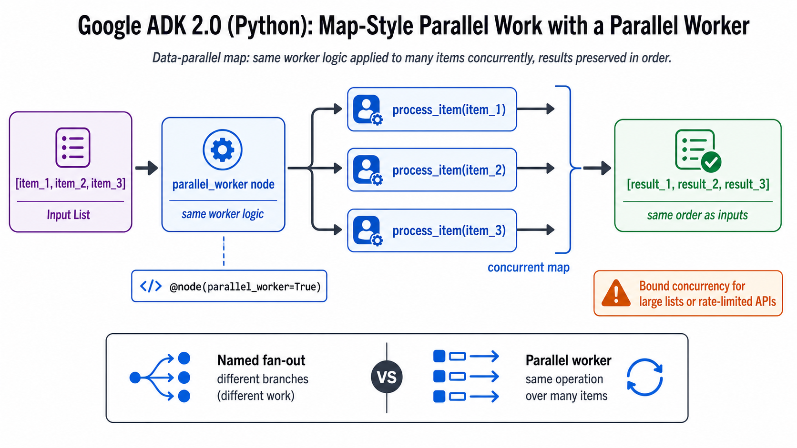

# Map-style Parallel Worker



## What it solves

The same operation is applied concurrently to every item in a list, producing an
ordered result list.

```text
[item_1, item_2, item_3] -> worker(item_1)
                         -> worker(item_2) -> [result_1, result_2, result_3]
                         -> worker(item_3)
```

## ADK expression

A graph node marked `parallel_worker=True` receives a list, activates one worker
per item, and returns results in input order.

```python
from google.adk.workflow import node

@node(parallel_worker=True)
def process_item(node_input: int) -> int:
    return node_input * 2
```

A dynamic workflow can express the same idea by collecting `ctx.run_node(...)`
futures and awaiting them with `asyncio.gather`.

## Use when

- Work is homogeneous and data-parallel.
- Items are independent.
- Input and output order should correspond.

## Avoid when

- Branches have different responsibilities.
- Item processing depends on earlier items.
- Unbounded concurrency would exceed provider or API limits.

## Failure modes

- Large lists create excessive concurrency and rate-limit failures.
- One failed item may fail the whole gather operation.
- Side-effecting workers are not idempotent under retries.

## Nearest neighbor

[Fan-out and gather](../fan-out-parallel-gather/) creates different named branches;
a parallel worker clones one operation across data items.

## Source

[Official dynamic parallel execution documentation](https://adk.dev/graphs/dynamic/#parallel-execution-routes)

