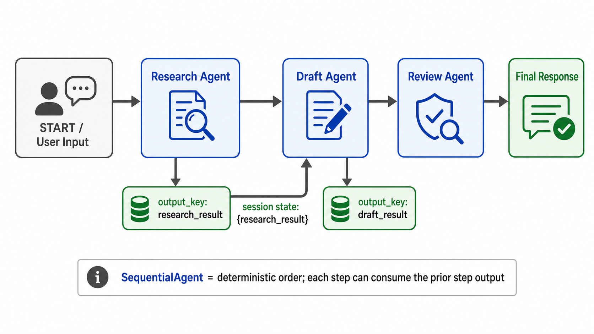

# Sequential Pipeline



## What it solves

A sequence runs a known set of stages in a fixed order. Each stage can consume the
previous stage's result.

```text
input -> validate -> process -> report -> output
```

## ADK expression

Existing ADK code commonly uses `SequentialAgent`. In an ADK 2.x graph, the same
shape is represented by a chain of edges.

```python
pipeline = SequentialAgent(
    name="data_pipeline",
    sub_agents=[validator, processor, reporter],
)
```

Template agents usually pass data through shared session state: an earlier agent
writes `output_key="validation_status"`, and a later instruction reads
`{validation_status}`. Graph nodes can pass typed `Event.output` values directly.

## Use when

- Every step is required.
- The order is stable and meaningful.
- Later stages depend on earlier output.

## Avoid when

- Independent stages could reduce latency by running concurrently.
- Only one branch should run based on a classification.
- The number of steps depends on runtime data.

## Failure modes

- A malformed early result contaminates every later step.
- Hidden state keys become implicit, fragile contracts.
- Unnecessary sequential work increases latency.

## Nearest neighbor

[Generate and review](../generate-review/) is a domain-specific sequential
pipeline with generator and critic roles.

## Source

[Official sequential pipeline pattern](https://adk.dev/workflows/patterns/#sequential-pipeline)

